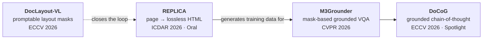
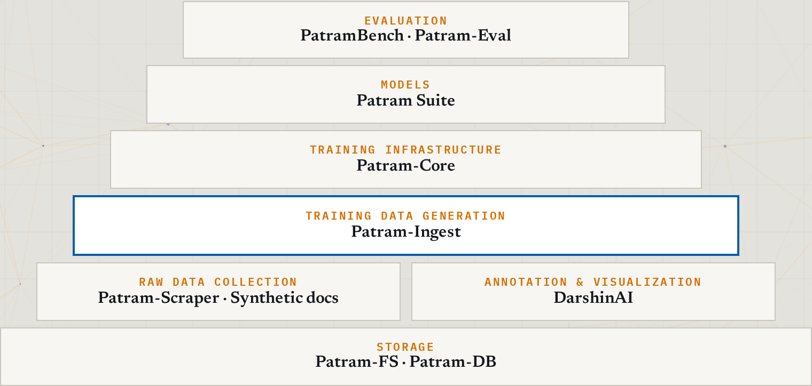

<h1 align="center">Hi, I'm Anirudh 👋</h1>

  <b>Senior Research Engineer · Vision-Language Models Team Lead at <a href="https://bharatgen.com/">BharatGen</a></b>

  
  
  
  
  

I'm a senior research engineer at BharatGen, where I lead the vision-language models team. My work covers answers that point to evidence on the page, the infrastructure for training and serving VLMs, and sovereign foundation models for India.

I write long-form explainers on how modern AI works, and each one comes with code you can run.

---

## 📖 The Backward Pass

**The Backward Pass is my blog series.** It explains how modern AI models are built, trained and scaled, from first principles. 70+ articles, interactive figures, cited sources, and a runnable lab for each theory post.

| | | |
|:--:|:--:|:--:|
|  |  |  |
| **[What Autograd Actually Does](https://srini-anirudh.github.io/blogs/what-autograd-actually-does/)** Backpropagation from scalar chain rules to saved tensors and checkpointing | **[Inside a Training Step](https://srini-anirudh.github.io/blogs/inside-a-training-step/)** Shapes, FLOPs, activation lifetimes, optimizer state and memory | **[Build Attention From Scratch](https://srini-anirudh.github.io/blogs/build-attention-from-scratch/)** MHA, GQA, MLA and tiled online softmax, tested against SDPA |

**Read:** [all articles](https://srini-anirudh.github.io/blogs/) · **Run:** [12 coding tutorials and a lab for every post](https://github.com/srini-anirudh/blog-coding-tutorials) · **Subscribe:** [RSS](https://srini-anirudh.github.io/feed.xml)

---

## 🔬 Research interests

I work on three connected problems. Each links to its page, its papers and its write-ups.

### 1. [Grounded document intelligence](https://srini-anirudh.github.io/research.html#grounded-document-intelligence)

*Turn pages into text without losing information, and ground every answer in the page with masks.*

Converting a document to text loses information, so we built a representation that keeps everything on the page: text, hierarchy, position and style. And a model that types out coordinates is a brittle way to ground an answer. People mark the page instead, so the VLM decides *what* to ground and *at what granularity*, and SAM highlights *where* as a mask.

**Thesis:** [Building Grounded Document Intelligence](https://srini-anirudh.github.io/blogs/building-grounded-document-intelligence/) · [talk and slides](https://srini-anirudh.github.io/research/docai-talk/)

<table>
  <tr>
    <td align="center" width="25%"> <b>REPLICA</b> Visually faithful document reconstruction ICDAR 2026 · Oral <a href="https://replica-agents.github.io/">project</a> · <a href="https://srini-anirudh.github.io/blogs/replica-visually-faithful-document-reconstruction/">blog</a></td>
    <td align="center" width="25%"> <b>M3Grounder</b> Multi-span, multi-granular grounding CVPR 2026 <a href="https://m3grounder.github.io/">project</a> · <a href="https://srini-anirudh.github.io/blogs/m3grounder-mask-based-document-grounding/">blog</a></td>
    <td align="center" width="25%"> <b>DoCoG</b> Mask-based grounded chain-of-thought ECCV 2026 · Spotlight <a href="https://docog-eccv.github.io/">project</a> · <a href="https://srini-anirudh.github.io/blogs/docog-grounded-chain-of-thought/">blog</a></td>
    <td align="center" width="25%"> <b>DocLayout-VL</b> Hierarchical, open-set, promptable layout ECCV 2026 <a href="https://doclayoutvl.github.io/">project</a> · <a href="https://srini-anirudh.github.io/blogs/doclayout-vl-promptable-layout-segmentation/">blog</a></td>
  </tr>
</table>

### 2. [VLM infrastructure](https://srini-anirudh.github.io/research.html#vlm-infrastructure)

*The whole stack that builds a sovereign vision foundation model, from storage to evaluation.*

   
  The Patram stack, read from the bottom up.

**Patram-Ingest** wraps vLLM in durable execution, so data-generation runs that last weeks keep GPUs busy and survive node failures. Talks: [guest lecture at IIIT Hyderabad](https://srini-anirudh.github.io/talks/programming-ai-accelerators/) · [vLLM Meetup Mumbai 2026](https://srini-anirudh.github.io/talks/patram-ingest-slides/)

### 3. [Sovereign foundation models](https://srini-anirudh.github.io/research.html#sovereign-foundation-models)

*The Patram series: India's document VLM, and the benchmark that measures it.*

- **[Patram](https://bharatgen.com/products/patram/)**: a vision-language model for Indian document understanding, built over BharatDocs, a corpus of 20M+ documents and 250M+ pages in English and 22 Indian languages. [Weights](https://huggingface.co/bharatgenai/patram-7b-instruct)
- **[Patram-Bench](https://patrambench.github.io/)** (ICDAR 2026): 52,607 documents, 23 languages, 52 tasks, 2.4M+ QA annotations, 29 VLMs evaluated.
- **e-vikrAI**: [Indic VLMs for e-commerce](https://bharatgen.com/products/e-vikrai/).

---

## 💻 Code

| Repo | What it is |
|---|---|
| [**blog-coding-tutorials**](https://github.com/srini-anirudh/blog-coding-tutorials) | 12 code-first tutorials, from PyTorch basics to VLM training and agent RL, plus one runnable lab with measured results for each post on the blog |
| [**srini-anirudh.github.io**](https://github.com/srini-anirudh/srini-anirudh.github.io) | Source of the website and blog |

Everything above is written up at <a href="https://srini-anirudh.github.io/">srini-anirudh.github.io</a>.

